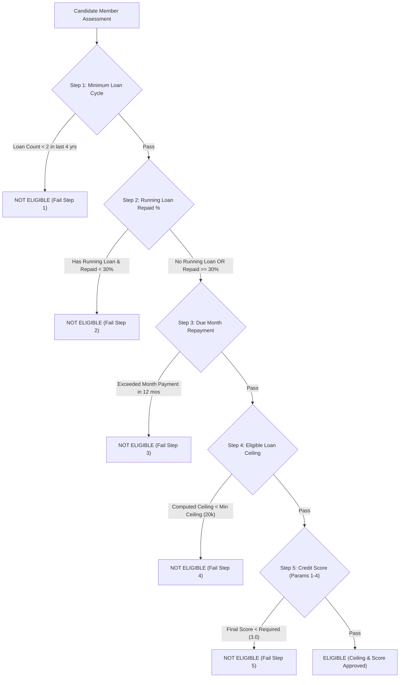

# BRAC Microfinance Nano Loan Project - QA Knowledge Base & Calculation Guide

## 1. System Overview & Environments

| Resource | Value | Notes |
| :--- | :--- | :--- |
| **Instance URL** | `https://env102-erp.bracits.net` | ERP Test Environment |
| **Eligibility Report** | `https://env102-erp.bracits.net/node/mfDashboard#!/microfinanceReport/nanoLoanEligibilityReport` | Month-wise Nano Loan Eligibility Report |
| **Eligibility Assessment Conf** | `https://env102-erp.bracits.net/node/mfDashboard#!/creditEligibilityAssessmentConf/create` | Central configuration screen |
| **Dabi Loan Product** | `https://env102-erp.bracits.net/node/mfDashboard#!/loanProduct/show/id=235` | Product ID: 235 |
| **Progoti Loan Product** | `https://env102-erp.bracits.net/node/mfDashboard#!/loanProduct/show/id=234` | Product ID: 234 |
| **Branch Office [0459] Login** | User: `97816` / Pass: `2ieRG*yh` | BAO / Branch User |
| **Head Office Login** | User: `mashuk` / Pass: `e8SP$YC@` | Program Admin / SA |
| **Database Host** | `10.150.150.52:4550` | EnterpriseDB PostgreSQL 15.7 |
| **Database Name** | `sbicloud_bd` | Main Core Banking DB |
| **Database User** | `aditya_2344` | QA / Read-only DB User |
| **Branch Office [0459] ID** | `578` (`BD400459` - Joypurhat) | Configured as `office.id` in `config/config.properties` |

> [!TIP]
> **Externalized Properties & Live Config Verification**: All environment URLs, `office.id`, `loan.product.dabi.id`, `loan.product.progoti.id`, branch/HO credentials, and DB connection parameters are centralized in `config/config.properties`. On every execution, the QA engine dynamically queries `loan_product`, `project_loan_product_mapping`, `loan_product_interest_rate`, `loan_product_policy`, `loan_product_details`, and all active `credit_risk_model_conf_*` tables for both Dabi and Progoti products and verifies the evaluated member's project against the matching configured loan product.

> [!IMPORTANT]
> **Performance & Partitioning Rule**: Core transaction tables (`loan_account_transaction`, `savings_account_transaction`, `loan_collection`) are physically partitioned by `office_info_id`. Always include `office_info_id` in SQL `WHERE` clauses to enable partition pruning; omitting `office_info_id` triggers full table scans across millions of rows.

---

## 2. Nano Loan Eligibility Evaluation Pipeline (5 Stages)

Eligibility is evaluated at month-end (e.g. October 2026, business date: `2026-10-31`) following a strict sequential 5-stage pipeline. A member must pass all 5 stages to become `ELIGIBLE`.

---

### Step 1: Minimum Loan Cycle Configuration
- **Purpose**: Verifies that the member has sufficient borrowing history with BRAC.
- **Criteria**:
  - Minimum number of General Loans: Configured as **2** (e.g. `credit_risk_model_conf_min_loan_cycle.minimum_loan_cycle`).
  - Installment Frequency: **Monthly** (`frequency_id = 3`).
  - History Lookback Window: Hard-coded **4 Years** (`history_years = 4`) from the Report Execution/Business Date (e.g. `2026-10-31 - 4 years` = `2022-10-31`).
  - Loan Statuses to Consider: Active (Current status 1) and Closed (status 2).
  - General Loan Product Types: Standard general loans (e.g. Dabi products 42, 46, 76, 79, 80, 96, etc.).
- **Evaluation Order**: Loans are sorted in **reverse chronological order** (latest disbursement date to oldest).
- **Failure Reason**: `"Only X general loan(s), minimum 2 required"`

---

### Step 2: Running Loan Repayment Requirement
- **Purpose**: Ensures active borrowers have made significant repayment progress on their current debt before taking a Nano Loan.
- **Criteria**:
  - Check if the member has an active running General Loan (`loan_status_id = 1`).
  - **Exception 1 (No running loan)**: If member has only closed loans, Step 2 is **automatically skipped** (Member passes Step 2).
  - **Exception 2 (Multiple running loans)**: If multiple active general loans exist, consider only the **most recently disbursed active loan**.
- **Exact Formula**:
  $$\text{Running Loan Repaid Percentage} = \frac{\text{Disbursed Amount} - \text{Outstanding Principal Balance}}{\text{Disbursed Amount}} \times 100$$
- **Threshold**: Required paid percentage is configured as **30%** (e.g. `required_paid_percentage = 30.0%`).
- **Failure Reason**: `"Latest running loan repaid X.X%, requires 30.0%"`

---

### Step 3: Due Month Repayment Criteria
- **Purpose**: Verifies installment repayment discipline within the evaluation period.
- **Criteria**:
  - Evaluation Period: Configured as **12 Months** (`due_month_evaluation_period = 12`, `MONTH`).
  - Evaluation Rule: **Within the Month**.
  - All installment payments during the lookback period must be paid within their respective due month.
  - Channel Considerations: System adjustment date applies for external channels (bKash, BFTN/HSBC). If payment adjusted after month-end, it is treated as late.
- **Failure Reason**: `"Repayment exceeded due month within evaluation period"`

---

### Step 4: Eligible Loan Amount Calculation & Project Ceilings
- **Purpose**: Calculates the credit ceiling based on historical borrowing volume.
- **Criteria**:
  - Number of Loans to Average: Configured as **2** (`number_of_loans_to_avg = 2`, equal to `minimum_loan_cycle`).
  - Selection: Latest $N$ general loans in reverse chronological order.
  - Eligible Loan Percentage: Configured as **20%** (`eligible_loan_percentage = 20`).
- **Formulas**:
  $$\text{Average Disbursed Amount} = \frac{\sum_{i=1}^N \text{Disbursed Amount}_i}{N}$$
  $$\text{Computed Ceiling} = \text{Average Disbursed Amount} \times 20\%$$
- **Project Min / Max Bounds**:
  | Project | Project Info ID | Minimum Eligible Ceiling | Maximum Eligible Ceiling |
  | :--- | :--- | :--- | :--- |
  | **Microfinance (Dabi)** | `1` | BDT 20,000 | BDT 50,000 |
  | **Progoti** | `2` | BDT 20,000 | BDT 100,000 |
- **Enforcement Rules**:
  - If $\text{Computed Ceiling} < \text{Project Minimum (20,000)}$: Member **FAILS Step 4** and is excluded!
    - Failure Reason: `"Computed ceiling <X> below project minimum 20000"`
  - If $\text{Computed Ceiling} > \text{Project Maximum (50,000 for Dabi / 100,000 for Progoti)}$:
    - $\text{Max Eligible Amount} = \text{Project Maximum}$
  - Otherwise:
    - $\text{Max Eligible Amount} = \text{Computed Ceiling}$
  - $\text{Min Eligible Amount} = \text{Project Minimum (20,000)}$

---

### Step 5: Credit Score Parameters & Final Score
A comprehensive behavioral assessment evaluating 4 independent credit risk parameters across the evaluated loans:

#### Parameter 1: Installment Payment Behavior (`INSTALLMENT_PAYMENT_BEHAVIOR`)
- Evaluates timeliness of each installment collection:
  | Behavioral Condition | Score |
  | :--- | :--- |
  | On scheduled date | 5.0 |
  | Within the month | 4.0 |
  | Within last 3 working days of the month | 3.0 |
  | Exceeding the month | 2.0 |
- **Aggregation Rule**: For each individual loan, assign the **lowest** score obtained across all installments.
- Loan scores are then averaged across the evaluated loans:
  $$\text{Param 1 Score} = \frac{\sum \text{Loan Score}_i}{\text{Number of Loans}}$$

#### Parameter 2: Savings Paid with Loan Installment (`SAVINGS_PAID_WITH_INSTALLMENT`)
- Measures savings deposit habits into compulsory savings (`savings_account_type = 1`) concurrent with loan installments.
- Evaluated as total savings deposits during loan term divided by total loan value / installments.
- **Scoring Bands (Dabi Member - Project 1)**:
  | Behavioral Condition | Score |
  | :--- | :--- |
  | $\ge 10\%$ deposited to savings | 5.0 |
  | $5\% \le \text{Deposit} < 10\%$ | 4.0 |
  | $1\% \le \text{Deposit} < 5\%$ | 3.0 |
  | $< 1\%$ deposited | 2.0 |
- **Scoring Bands (Progoti Member - Project 2)**:
  | Behavioral Condition | Score |
  | :--- | :--- |
  | $> 3\%$ deposited to savings | 5.0 |
  | $1\% \le \text{Deposit} \le 3\%$ | 4.5 |
  | $< 1\%$ deposited | 4.0 |
- Loan scores are averaged across evaluated loans to obtain `Param 2 Score`.

#### Parameter 3: Savings Adjustment of Previous Loan (`SAVINGS_ADJUSTMENT_PREV_LOAN`)
- Checks if the member settled loan dues using compulsory savings adjustments (`trx_type = 7`):
  | Behavioral Condition | Score |
  | :--- | :--- |
  | 0% adjustment made | 5.0 |
  | $>0\% \le 25\%$ adjustment | 4.5 |
  | $>25\% \le 50\%$ adjustment | 4.0 |
  | $> 50\%$ adjustment | 2.0 |
- Loan scores are averaged across evaluated loans to obtain `Param 3 Score`.

#### Parameter 4: Savings Withdrawal Before Repayment Date (`SAVINGS_WITHDRAWAL_BEFORE_REPAYMENT`)
- Considers withdrawals from compulsory savings across the last **11 installments** (`installments_to_consider = 11`) relative to repayment dates within **7 days** (`days_before_repayment = 7`):
  | Behavioral Condition | Score |
  | :--- | :--- |
  | Never withdrew | 5.0 |
  | All withdrawals before 7 days | 4.0 |
  | Any withdrawal within 7 days | 3.0 |
- Result is `Param 4 Score`.

#### Final Score Calculation
$$\text{Final Score} = \frac{\text{Param 1} + \text{Param 2} + \text{Param 3} + \text{Param 4}}{4}$$
- **Threshold**: Member qualifies if $\text{Final Score} \ge \text{Required Final Score}$ (Configured as **3.0** in Run 2, or **4.0** in standard policy).
- Failure Reason: `"Final score X.XX below required threshold"`

---

## 3. Database Schema Reference

### 3.1. Credit Risk Model Tables
- `credit_risk_model_conf_min_loan_cycle`: Configuration for Step 1.
- `credit_risk_model_conf_running_repayment`: Configuration for Step 2.
- `credit_risk_model_conf_due_month_repayment`: Configuration for Step 3.
- `credit_risk_model_conf_loan_amount_calc`: Configuration for Step 4.
- `credit_risk_model_conf_final_score`: Configuration for Step 5 final score cutoff.
- `credit_risk_model_conf_credit_score_band`: Scoring bands for all 4 parameters.
- `credit_risk_model_conf_credit_score_parameter`: Parameter master definitions.
- `credit_risk_model_eligibility_run`: Batch run execution log (contains `config_snapshot`, status, counts).
- `credit_risk_model_eligibility_candidate`: All evaluated members in Stage A (Steps 1 to 4) with `stage_a_status`, `fail_step`, `fail_reason`.
- `credit_risk_model_eligibility_candidate_loan`: Evaluated general loans for each candidate.
- `credit_risk_model_eligibility_score_detail`: Step 5 scoring details per parameter and per loan.
- `credit_risk_model_eligible_member`: Final results table containing `eligibility_status` (`ELIGIBLE` / `NOT_ELIGIBLE`), ceilings, scores, and failure reasons.

### 3.2. Core Banking Entity Tables
- `member_info`: Member master (`id`, `member_no`, `member_name`, `branch_info_id`, `project_info_id`).
- `loan_account`: Loan master (`id`, `account_no`, `loan_status_id`, `disbursed_amount`, `outstanding_balance`, `disbursement_date`).
- `loan_product`: Loan products (`id`, `name`, `loan_product_type_id = 1` for General Loan).
- `loan_installment`: Schedule installment rows (`loan_account_id`, `installment_no`, `due_date`, `total_amount`).
- `loan_account_transaction`: Partitions by `office_info_id` (`loan_account_id`, `collection_amount`, `transaction_date`, `trx_type`).
- `savings_account`: Member savings accounts (`member_id`, `savings_account_type_id = 1` for Compulsory Savings).
- `savings_account_transaction`: Partitions by `office_info_id` (`member_info_id`, `deposit_amount`, `withdrawal_amount`, `date_created`).

---

## 4. Key Transaction Types

### Loan Account Transaction Types (`trx_type`)
- `1`: Disbursement
- `2`: Provision
- `3`: Collection (Normal Installment Collection)
- `6`: Settlement
- `7`: Savings Adjustment
- `13`: Smart Collection
- `19`: bKash Collection
- `20`: Bank Collection

### Savings Account Transaction Types (`trx_type`)
- `1`: Deposit (Member savings deposit)
- `2`: Withdrawal (Cash withdrawal)
- `3`: Adjustment
- `4`: Interest Deposit (Excluded from member savings behavior calculation)
- `6`: Principal Withdrawal
- `7`: Interest Withdrawal
- `9`: Collection from Loan
